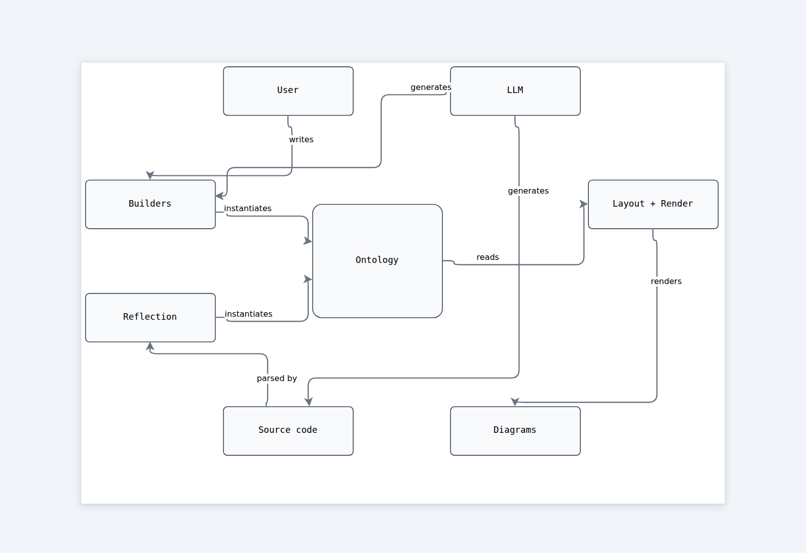

# sysatlas

[](https://github.com/sponsors/CServinL)

**For software architects who keep redrawing the same diagram because it
got unreadable — and for the AI coding assistants that keep the
diagrams in sync with the code.**



Most diagram tools let you cram everything onto one canvas, then leave
you fighting the layout engine. sysatlas does the opposite: focused
views (~10 components each), and **splitting one system into many
small diagrams** is a first-class operation.

It works in both directions:

### Forward — design before code

You describe a system in Python and:

- **Split** it into focused views — *storefront*, *payments*,
  *async backbone* — each one fits on a slide.
- **Cross-reference** between views with auto-detected stub nodes, so a
  component defined in one view shows up as a ghost reference in others.
- **Annotate** components with ISO 25010 quality attributes
  (`security: critical`, `performance: high`) — rendered as coloured
  badges.
- **Trace** how things relate across views (`Cart depends_on Payments`,
  `APIController realizes API`) using SysML link vocabulary.
- **Ground** the whole thing in ISO 42010 (Stakeholders / Concerns /
  Viewpoints / Views) so the *why* is captured alongside the *what*.

### Backward — reflect after the code lands

You point sysatlas at an existing source tree and it reads the real
structure:

```python
import sysatlas

# Python project
r = sysatlas.reflect("src/")
m = r.to_system_map(title="src internals")
m.save("docs/reflection/module-map.html")

# …or a deterministic, token-cheap text map of the architecture —
# components and their dependency tiers, entry points, external systems,
# data models, config, cycles, hotspots — for an LLM to hold a holistic
# view without reading the source:
r.save_atlas("docs/reflection/atlas.md", title="src",
             intent="docs/reflection/intent.json")   # optional, see below

# Rust crate  (pip install 'sysatlas[reflect-rust]')
r = sysatlas.reflect_rust("my-crate/")
m = r.to_system_map(title="my-crate internals")
m.save("docs/reflection/module-map.html")
```

Static analysis — no execution, safe on broken or uncompiled code. The
output is the same `SystemMap` the forward flow produces, so a thin
human-authored "annotation overlay" (qualities, traces, viewpoints)
can be merged onto reflected structure via `r.merge_with(overlay)`.
Drift between intent and reality becomes visible instead of silent.

#### What the atlas is for

`atlas.md` is a **mirror of how the code is actually organized** — generated,
never hand-written, so it cannot drift from the source. It maps:

- **Components** — clusters of modules that act as one unit (import cycles,
  shared packages, helpers with a single caller), ordered into dependency tiers.
- **Entry points** — `__main__` guards, `[project.scripts]`, web routes, CLI
  commands, background tasks.
- **External systems** — databases, HTTP APIs, queues, cloud and model APIs,
  inferred from imports.
- **Data models**, **environment variables**, import cycles, coupling hotspots.
- **Pattern candidates** — architectural patterns whose structural footprint
  was found (layered, pipeline, ports and adapters, strategy, facade, fluent
  builder, plugin registry, repository, event-driven, client and server,
  commands), each with its evidence. The `sysatlas-document` skill confirms or
  rejects them by reading the source.
- **Conformance** — if the hints file (`sysatlas.json`) declares an
  `architecture` (planned components and which may depend on which), the atlas
  reports every dependency the plan does not allow.

Imports cannot show what a component is *for*. That part lives in an optional
`intent.json` (summary, component purposes, architectural patterns), written by
a person or by an LLM with the `sysatlas-document` skill, merged into the atlas
and marked as not generated. Each entry carries a fingerprint of the component's
public symbols, so the atlas flags an entry as stale when the code changes shape.

Among its use cases:

- **Orientation** — an LLM or a new contributor gets the whole-repo picture
  without reading the source.
- **Plan vs. reality** — pair it with an app spec (the *intended* design,
  written by people) and compare what was planned with what the code became.
- **Review** — commit it with the code so a diff shows structural change.

### The intended loop

1. **Plan** the change with a forward-flow diagram on a feature branch.
2. **Implement** the feature.
3. **Reflect** the branch (`sysatlas.reflect(...)`) and commit the
   regenerated diagrams alongside the code. Reviewers see structure
   and intent change together.

Output is a single self-contained HTML file — no server, no extra
runtime dependencies, opens in any browser.

```bash
pip install sysatlas                        # Python reflection included
pip install 'sysatlas[reflect-rust]'        # + Rust crate reflection
```

## Using sysatlas with an AI coding assistant

sysatlas ships a guide aimed at LLMs. Tell your coding assistant
(Claude Code, Cursor, Aider, …) to read it before working on this
repo. The one-liner to paste into your `CLAUDE.md` / `.cursorrules` /
`AGENTS.md`:

> Before editing this project, read sysatlas's LLM guide:
> `python -c "import sysatlas; print(sysatlas.llm_guide())"`, then read
> the architecture atlas at `docs/reflection/atlas.md` for a holistic
> view of the codebase. After any structural change (add/remove/rename
> modules or components), regenerate the atlas and the affected diagrams
> under `docs/reflection/` using `sysatlas.reflect(...)` and commit them
> with the code change.

The guide tells the assistant exactly which symbols are public, which
fields the ontology accepts, and that diagrams are part of the
deliverable — not an afterthought.

### Installing the sysatlas Skills (Claude Code)

sysatlas ships two Claude Code Skills so Claude auto-discovers how to use it —
no manual reminder needed:

- `sysatlas` — how to use the library; read the atlas first; regenerate after
  structural changes.
- `sysatlas-document` — fill the atlas's "Documentation gaps": write missing
  docstrings, component purposes and architectural patterns.

Ask your assistant to install them once per project:

> Install the sysatlas skills: for each name in `sysatlas`, `sysatlas-document`,
> copy the file at `python -c "import sysatlas; print(sysatlas.skill_path('NAME'))"`
> to `.claude/skills/NAME/SKILL.md` in this project.

## Where to look

- Runnable feature-by-feature showcases live in
  [`docs/demos/`](docs/demos/) — start with
  [`docs/demos/architecture.py`](docs/demos/architecture.py).
- Design philosophy: [`docs/design-principles.md`](docs/design-principles.md).
- Full app index: [`docs/README.md`](docs/README.md).
- How sysatlas relates to C4 / ArchiMate / UML / BPMN / ISO 42010:
  [`docs/state-of-the-art.md`](docs/state-of-the-art.md).

Apache 2.0 licensed.
